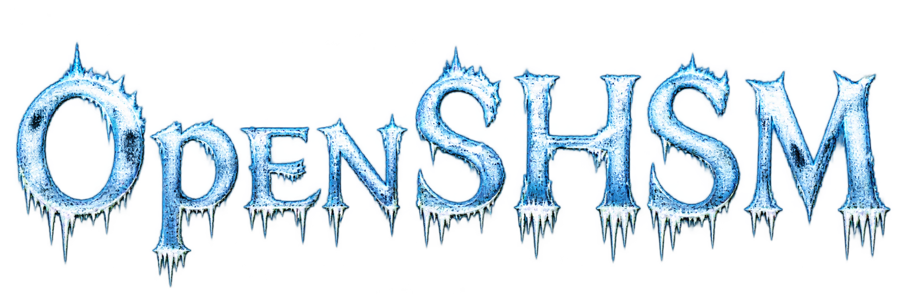

# OpenSHSM

OpenSHSM is an experimental static recompilation of the Wii version of
Silent Hill: Shattered Memories. It does not contain the game, its executable,
assets, saves, or generated translation units. Every build requires the user's
own Wii copy.

## Supported input and current status

The only validated input is Wii US `R5WEA4`, revision 0. Other regions and
revisions are unverified. The recompilation has experimental macOS runs; full
game progression, performance, sound, and controller acceptance remain open.
A Windows 11 test compiled and linked 75 guest, 44 runtime, and 5 host objects.
A 20-second headless run loaded `R5WEA4`, started the guest CPU, and advanced
through the scheduler and VI path. That run did not test graphics, audio,
controllers, or playability.

The experimental macOS desktop adapter uses relative mouse movement and the
right stick for world-camera look, with accumulated pitch retained on release.
The adapter follows the original camera manager's copied player state. Offline
checks exercise the original player heading update through repeated full turns;
in-game character and camera behavior still needs acceptance.
World-look speed is configured in the existing user `config.toml`, under `[input]`:
`mouse_look_sensitivity = 1.0` and `gamepad_look_sensitivity = 1.0`.
Both are independent multipliers in the range 0.05–5; 1 preserves the previous
speed and 0.5 halves it. Missing keys preserve defaults; invalid values or types
are ignored, preserving the current valid value. Restart after editing. These
settings affect world camera/flashlight look, while menu/puzzle pointing and
object manipulation use their own pointer/motion paths. F1 also names these settings.

Before starting a game, the launcher opens settings for window size, desktop
fullscreen and mouse/gamepad look sensitivity. It edits the same user config;
Cancel closes without starting a game, Save keeps the dialog open, and Play
saves then starts. Python 3.11+ with Tk is required for this dialog.
`--settings-only` edits without starting; `--no-settings` launches directly.
`--check-only` and `--build-only` never open the dialog. On Windows the launcher
integration is implemented but has not been tested on a real Windows machine.

F2 opens display settings with five window sizes; F11 switches between windowed
and desktop fullscreen. These choices are saved to the existing user config,
preserving other TOML values. `[graphics]` also accepts `fullscreen = false`,
`window_width` (320–8192) and `window_height` (240–8192). Fullscreen uses the
desktop display size; these settings do not increase the internal Wii EFB
resolution. The desktop helper centers the flashlight ray in normal/held-look
states and enables original beam reaim; actual hand/model placement and zoom
transitions still need in-game acceptance. PS2 is the standard-gamepad reference
for interactions and puzzles. In a validated active common interaction, hold A
to grab, release A to let go, B to go back, and use the left stick for the
pointer/manipulation. For native twist interactions, hold A and move the left
stick in a circle; the pointer stays fixed during the turn. Other contexts
retain their existing bindings. Full puzzle and phone/menu mapping is pending;
offline fixtures do not establish in-game completion.

Menus and grabbed objects retain pointer input. In desktop mode the focused
window captures the mouse automatically and releases it on focus loss or
minimization. F1 shows the bindings; F10 toggles mouse release/capture. Returning
to the window restores capture automatically. A released mouse does not restore
the old pointer-driven world camera. These PC adaptations use PS2 research as a reference and
require no PS2 files. Full camera, flashlight, puzzle and physical-controller
acceptance remains pending. The Nunchuk startup splash is skipped on PC;
supporting physical Wiimote and Nunchuk input remains a separate requirement.

The experimental renderer decodes the verified full-frame intensity-copy/C8
brightness view on the GPU, applying the native palette and declared sampling
extent. Storage is reused and refreshed on copy or palette changes; no frame
readback to the CPU is used. Other copy reinterpretations remain unverified.
Cache/state/arithmetic checks use mocks or CPU execution; actual GLSL, GPU image,
brightness and performance acceptance remain pending.

Optional diagnostics: `OPENSHSM_TRACE_DESKTOP_LOOK=1` records at most 64 aim
snapshots in the existing console log, starting after desktop world look becomes
active. It reports player target/state, attachment matrices and a matched cTorch
receiver. Other values disable it. It does not capture images or audio, change
saves, or enable a flashlight fix. Actual gameplay capture remains unverified.

## Repository layout

- `experiments/wii-static-recomp/` contains the active recovery, build, launch,
  and verification code.
- `OpenSHSM.command` opens first-run import/settings and launches a verified macOS build.
- `OpenSHSM-Windows.ps1` provides the same flow for an already-built Windows tree.
- `licenses/` contains required third-party notices.

There are no symbolic links. Local game data, generated code, build output,
toolchains, and caches must stay outside version control.

## Prepare your own Wii copy

On first launch without `--game-data`, the launcher offers to import your own
Wii image or an already extracted DATA directory. Select an external
`DolphinTool`/`dolphin-tool` executable supporting `extract --gameonly` for image
input; the launcher searches PATH and the standard macOS Dolphin application
location, then lets you browse. DolphinTool is not bundled or downloaded.
The dialog lists common Wii image extensions; acceptance depends on the selected
decoder and the supported game manifest, not the filename extension.

The importer runs off the UI thread, shows activity, then checks every required
file. It exposes the managed `wii-import/DATA` directory only after success.
On failure it preserves a uniquely named `wii-import.partial-*` directory and
the extractor log for diagnosis; a retry uses a fresh directory. Nothing is
automatically deleted. Existing imports are checked again on subsequent runs;
damaged files stop launch rather than being silently overwritten.

Data lives under `~/Library/Application Support/OpenSHSM` on macOS or
`%LOCALAPPDATA%/OpenSHSM` on Windows, alongside the existing config and saves.
`--user-dir` overrides this location. Cancel does not start the game.
`--check-only`, `--build-only` and `--no-settings` do not open the import UI.
Explicit `--import-image IMAGE --dolphin-tool TOOL` allows unattended import;
it cannot be combined with `--check-only` or `--game-data`.

Import without building or launching (macOS):

```sh
python3 -B experiments/wii-static-recomp/build_and_play_current.py --import-only
```

Add `--no-settings --import-image /path/to/own.iso --dolphin-tool /path/to/DolphinTool`
for the command-line equivalent. This source repository contains no game binary:
after import you must build with the dependencies below. The root launchers
look for `build/<version>/build` by default; use `--owner-build` on macOS or
`-BuildDir` in PowerShell for another verified build directory. The preparation
pipeline writes the executable into `<destination>/build`.

First-run controller and error-path checks use synthetic data and a simulated
extractor. Actual Tk display, Windows wrapper execution and real-image extraction
remain unverified. A real supported image and DolphinTool are still required
for clean-machine acceptance.

Only Wii US `R5WEA4`, revision 0 is accepted. For an already extracted DATA
directory, run from the repository root:

```sh
python experiments/wii-static-recomp/prepare_wii_us_copy.py \
  --source /path/to/own/DATA --destination /path/to/new/private-import
```

For a disc image, the same script accepts `--image /path/to/own-image` and
`--dolphin-tool /path/to/DolphinTool` instead of `--source`. This requires an
external DolphinTool with the `extract --gameonly` command (see the
[upstream extract options](https://github.com/dolphin-emu/dolphin/blob/master/Source/Core/DolphinTool/ExtractCommand.cpp)). Real image
extraction remains unverified; simulated extractor checks only cover the
interface and error handling.

The destination must be fresh and outside the original DATA, including when
parent paths contain symbolic links. Successful preparation writes `DATA/`
and `import.json` after checking every required file against the supported
copy's SHA-256 manifest. Keep that entire import directory private. Use its
`DATA` path for `--game-data` in the owner build and launch commands. On macOS,
use `python3` if `python` is unavailable. In PowerShell, put the command on one
line and quote paths containing spaces.

Import validation does not establish game launch, sound, controllers, or full
game progression. Build tools and SDKs remain separate external dependencies.

## Experimental desktop QTE textures

The optional preparation tool requires Python 3.11+ and Pillow
(`python3 -m pip install Pillow`). It reads the supported own-Wii DATA directly,
without a developer catalogue or PS2 files:

```text
python3 experiments/wii-static-recomp/prepare_desktop_qte_glyphs.py --game-data /private/path/DATA --output /private/path/qte-glyphs
```

Use a fresh output directory outside DATA. Keep the TXD, previews and report
private: the generated texture container derives metadata from your Wii copy.
The eight button/arrow shapes are procedural OpenSHSM contributions. This tool
does not install textures or replace game hints. Its output has matched the
separately CPU-tested native bank; native presentation and controller/gameplay
acceptance remain pending. The isolated check used Pillow 12.3.0 on macOS;
other Pillow versions and operating systems have not been checked.

For an experimental owner build, append `--prepare-desktop-qte` to the existing
`assemble_stock_owner_sources.py` command. That stage prepares the bank from
its verified Wii DATA and writes a private descriptor into the assembled tree.
The builder verifies both the descriptor and the pinned bank digest before
compiling. The normal source/SDK include paths use the same descriptor; no
game-time file registry or PS2 asset is required. Use Pillow 12.3.0 for the
checked output. Without this assembly option the descriptor is absent and
automatic bank loading is disabled. Neither mode replaces hints yet.
Never copy `desktop-qte/` or `openshsm_owner_qte_payload.h` into public sources.

## macOS build and launch

Install Python 3.11 or newer and Xcode Command Line Tools. Supply the pinned
NWiiRecomp source/tool, SDL2 headers and static library, GLAD headers and static
library, toml++ headers, and the pinned Dolphin FloatUtils source. Run
`experiments/wii-static-recomp/prepare_build_stock_owner_macos.py --help`
for the complete explicit build command. Generated sources and original game
data belong in private directories outside this source tree.

The 0.0.96 source archive was unpacked into an empty directory on the development
Mac. Its launcher imported the owner's Wii US R5WEA4 revision 0 RVZ, then the
public preparation/recovery/build pipeline compiled all 125 objects from that
fresh DATA tree. The recovered sources and 225 public headers matched the local
0.0.96 build. The public launcher passed `--check-only` using this fresh build
and the managed import, without an image or DolphinTool argument on reuse.
The test reused a validated compiler and SDK cache on the same Mac. No game,
GUI or device was opened. Fresh dependency installation on an independent
machine, Windows compilation and gameplay acceptance remain open.

With a toolchain report produced on this machine, build into a fresh private
directory:

```sh
python3 -B experiments/wii-static-recomp/prepare_build_stock_owner_macos.py \
  --game-data /path/to/private-user/wii-import/DATA \
  --toolchain-result /path/to/toolchain/toolchain-result.json \
  --dolphin-core /path/to/dolphin/Source/Core \
  --destination /path/to/private-build --jobs 4
```

The toolchain report records absolute dependency paths. Prepare it locally;
copying another machine's report does not install its dependencies.

Prepare a copy of the supplied pinned NWiiRecomp source before building its
tool executable:

```sh
python3 experiments/wii-static-recomp/prepare_stock_nwii_source.py \
  --nwii-source /path/to/upstream-source --destination /path/to/prepared-source
```

This verifies revision `595f176f1d24cc54ff2e8389feed12d7fb553cc2` against the
public 89-file manifest and removes its false IOS signature. Rebuild the
recompiler from this prepared source; an older executable is rejected after
stock export. `prepare_stock_macos_toolchain.py --help` lists the pinned source
archive inputs for the bundled macOS dependency build. Archives and SDKs must
be supplied separately. On macOS, use a local APFS directory for CMake and the
prepared upstream tree: AppleDouble `._*` sidecars on external filesystems can
be mistaken for compiler source files by upstream globs.

The pinned SDL2 build backports the upstream `SDL_JOYSTICK_MFI` opt-out hint.
If the Apple backend finds no devices and this environment setting is absent,
the host retries through SDL's existing HID backend. Set `SDL_JOYSTICK_MFI=1`
to keep the Apple backend, or `0` to request HID explicitly. The original SDK
sources are preserved; the public preparation applies the bounded patch.

In input mode6, F1 shows desktop bindings. Hold both mouse buttons and move to drag objects. Alt+horizontal drag or
Z/X rotates the virtual Wiimote; R centers it. Gamepad A maps to Wii A, B/RT to Wii B, LB/LT to Nunchuk C/Z;
the left stick walks. In eligible world-camera mode the right stick looks;
in menus and interactions it points. While A+B or A+RT is held,
move the left stick in a circle to rotate a grabbed twist object; the right stick
still drags or points. Holding a stick direction does not keep rotating.
Mouse capture follows window focus and F10; gamepad pointing does not release it. These are PC adaptations. Nunchuk
motion, full physical Wiimote input and full-game acceptance remain unverified.
8BitDo Ultimate2C on this development Mac was detected and its sticks,
triggers and several buttons read over Bluetooth HID; USB and gameplay
acceptance are still open. This is not a claim about every controller.
The ADMA adapter converts Wii right/left memory pairs to SDL left/right output.
Synthetic channel-isolation checks cover both supported sample rates; audible
gameplay and camera-puzzle acceptance remain open.
In desktop input mode6, the original phone-audio option reads as TV output.
The stored preference is preserved and other input modes retain the original
value. This PC adaptation reuses the original routing; audible ringtone,
phone dialogue and complete sound acceptance still require gameplay checks.
The windowed host loop includes rendering and buffer swapping in its nominal
60 Hz wait budget. Incomplete visible passes use a 1 ms polling deadline so
partial GX work can continue sooner. Game input sampling stays capped near
60 Hz, independently of faster event/FIFO polling. Slow iterations add no
unconditional sleep; headless passes retain the previous deadline.
This host pacing adaptation is not a verified gameplay FPS increase or a
change to the original Wii timebase; stable 60+ FPS remains unverified.
Per-draw snapshot timing is disabled during ordinary launches. Direct diagnostic
runtime runs can enable `NWII_GX_SNAPSHOT_TIMING=1`; the standard launcher clears
this variable. Aggregate parse/decode counters remain enabled. Supplied CPU draw
streams showed lower parser cost, but this is not a gameplay FPS measurement.
EFB texture and retile cache keys preserve Wii MEM2 bank bits and cached/
uncached aliases. Mocked-GL address tests cover separate banks and ordinary
texture decoding; visual flicker and full-game graphics still need validation.
The DI device module is compiled with `-O2` on both build paths. Its original
MMU byte writes and watchpoints remain; isolated reads of the owner's Wii data
were measured on macOS. Build reports record `dependencies.runtimeO2Members`.
Windows performance and in-game audio/frame-time improvements are unverified.

Optional developer diagnostics (`NWII_DSP_SUPPLY`) report ADMA supply and
`AXJobAccounting` in the same host snapshot. Job counters include submitted,
completed and failed work, execution time, start/idle gaps and in-flight work.
`FMODEventAccounting` counts completed original Event::start API returns,
nonzero statuses and the last status/error before the resource layer can hide
them. A zero status does not prove that voices or story audio were produced.
Printing stays outside the audio callback and ring lock. Diagnostics are off
by default; standard launchers sanitize debug environment settings, so use an
explicit diagnostic process when collecting these counters. They describe
native execution, not original DSP cycles or accepted gameplay performance.

After preparing an owner build, launch from this repository root:

```sh
./OpenSHSM.command --owner-build /path/to/private-build/build \
  --game-data /path/to/own/DATA --user-dir /path/to/own/user
```

The user directory holds `config.toml`, saves and bounded runtime logs. Existing
settings are preserved; a missing config is initialized from the public example.
Add `--check-only` to validate build hashes, version and Wii DATA without creating
or changing the user directory. Owner mode launches an existing build and does
not use the developer's preview checkout. The no-argument local development flow
prefers an installed version-matching owner cache when available; otherwise it
requires local private preview inputs. Do not combine owner mode with
`--build-only` or `--config`; use `--user-dir/config.toml` for its settings.

Successful validation or startup does not prove full-game playability, sound,
controller support or performance.

The AXWii audio adapter includes the generated free DSP coefficient replacement
from Dolphin revision `e2ad09306e6d371f7272205bdc363da9fe05fe08` (stgn/ligfx,
GPL-2.0-or-later). It is a PC filter approximation, not Nintendo's original
coefficient ROM. No external DSP ROM or Dolphin installation is needed at
runtime. To reproduce and check the included coefficient header with standard
Python, run:

```sh
python experiments/wii-static-recomp/generate_stock_axwii_coefficients.py --check
```

## Windows build

Install Python 3.11 or newer and supply explicit paths to:

- the pinned NWiiRecomp source and `nwiirecomp.exe`;
- Zig 0.14.1;
- SDL2 MinGW headers, import library, and `SDL2.dll`;
- GLAD headers and a MinGW static library;
- toml++ headers;
- Dolphin source revision `e2ad09306e6d371f7272205bdc363da9fe05fe08`,
  used only for the pinned `FloatUtils` source;
- an extracted Wii US R5WEA4 revision 0 `DATA` directory.

Run `experiments/wii-static-recomp/prepare_build_stock_owner_windows.py --help`
for the complete explicit command line. It regenerates private translated
sources from the user's Wii copy and writes them only to the selected build
directory. Launch with:

```powershell
.\OpenSHSM-Windows.ps1 -BuildDir C:\OpenSHSM-build\build `
  -GameData C:\Games\SHSM\DATA
```

`--check-only` on the Python launcher validates hashes and paths without
starting the game. A successful compile is not proof of playable Windows
behavior.

## Publication and licensing

NWiiRecomp has a custom non-commercial source-available license preserved in
`licenses/NWiiRecomp-LICENSE.txt`. It is not an OSI-approved open-source
license. Original OpenSHSM contributions use the same custom non-commercial
conditions in `licenses/OpenSHSM-LICENSE.txt`; see `LICENSE.md` for scope and
third-party exceptions.

Konami game code and resources are not distributed. Development and
verification were assisted by OpenAI Codex.
